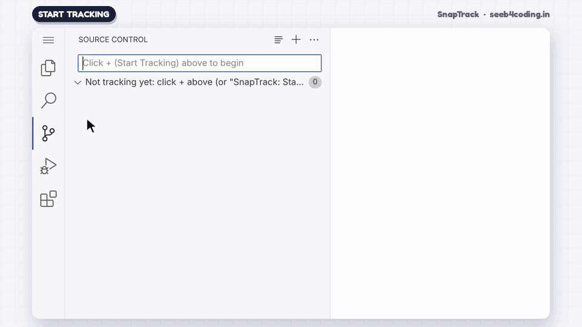

# SnapTrack: Local History & Undo Without Git

[](https://marketplace.visualstudio.com/items?itemName=seeb4coding.snaptrack)
[](https://marketplace.visualstudio.com/items?itemName=seeb4coding.snaptrack)
[](https://marketplace.visualstudio.com/items?itemName=seeb4coding.snaptrack&ssr=false#review-details)
[](https://github.com/seeb4coding/snaptrack)
[](LICENSE)

**[Install from the VS Code Marketplace](https://marketplace.visualstudio.com/items?itemName=seeb4coding.snaptrack)** or run `ext install seeb4coding.snaptrack` in Quick Open (`Ctrl+P`).

**Not using Git on a small project, a client site or a quick script?**
SnapTrack gives any folder undo and history: see what changed, review a side-by-side diff, then keep it or throw it away. There's nothing to set up and no Git required.



▶ **[Watch the 4-minute demo on YouTube](https://youtu.be/6h8j-ytF-9Q)**

---

## Why SnapTrack?

- **No Git needed.** Works in any folder, in seconds.
- **See every change.** Modified, added and deleted files show **M / A / D** in Source Control and the Explorer, with gutter bars in the editor.
- **Undo safely.** Discard one file or everything, and a safety checkpoint is saved first so nothing is ever lost.
- **Go back in time.** Auto checkpoints, full commit history, file history and one-click restore of the whole project.
- **Plays nicely with Git.** If the folder already uses Git, SnapTrack never touches it.

Good for beginners, designers, WordPress/PHP sites, client projects, experiments, and anyone who has ever thought *"what did I just break?"*

---

## Quick start

1. Open a folder in VS Code.
2. Go to **Source Control** (`Ctrl+Shift+G`) → **Start Tracking This Folder**. SnapTrack saves a first snapshot.
3. Edit, add or delete files. They appear under **SnapTrack → Changes**.
4. Click a file to see a **side-by-side diff** (last commit ↔ now).
5. Happy with it? Type a message and press `Ctrl+Enter` (or click ✓) to **commit**. You'll be asked to confirm.
   Not happy? Click **Discard** (↶) on a file, or **Discard All**.

That's it. Your history now builds up as you work.

---

## Features

### Changes and diffs
- **M** (modified), **A** (added) and **D** (deleted) badges in Source Control and the Explorer.
- Green, blue and red gutter bars in the editor.
- Side-by-side diff for every changed file.
- Commit everything, or use ✓ on a single file to commit only that file.
- Leave the message empty and SnapTrack suggests one, like *Update index.php (+1 new)*.
- **Revert Change at Cursor** (right-click in the editor) puts back just the changed block you're on. `Ctrl+Z` brings it back.
- **Hover any line** to see which commit or checkpoint last changed it.

### Discard with a safety net
- Discard one file or all changes. Each goes back to the last commit (new files are deleted).
- You're always asked first, and **a checkpoint is saved before every Discard and Restore**, so you can always get back.

### History panel
Under Source Control you'll find **SnapTrack History**, listing commits (●) and auto checkpoints (💾).
- Expand any entry to see its files, then click one for the diff.
- Each entry shows how many lines it added and removed (`+12 −4`).
- Right-click an entry for: **Compare with Current Files**, **Select for Compare → Compare with Selected**, **Restore Project to This Commit**, **Export .patch / .zip**, or **Pin** (pinned entries are never removed by Clean Up).
- 🔍 **Search** the history by message, file name or date.
- **Recently deleted** at the top lists files that are in your history but gone from disk. Click to see one, or restore it in one click.

### File history
The **SnapTrack File History** panel shows every saved version of the file you have open. You can compare or restore any of them.

### Auto checkpoints
- A checkpoint is saved automatically every 10 minutes (`snaptrack.autoCheckpointMinutes`).
- Optionally, one is saved on every file save (`snaptrack.checkpointOnSave`).
- **Save Checkpoint As…** gives a checkpoint a name, like *before refactor*. Named checkpoints are pinned automatically.
- Checkpoints never change your Changes list.
- The status bar shows your change count and how long ago the last checkpoint was saved.

### Undo Last Commit
Removes the last commit but keeps your files. The changes and the commit message come back so you can redo it.

### Outgrown SnapTrack? Convert to Git
**Convert History to a Git Repository…** (in the History **…** menu) creates a new folder with a real Git repository. Each SnapTrack commit becomes a Git commit with the same message, date and files. Checkpoints are left out. Your project folder isn't changed. Git must be installed.

### Multiple folders
In a multi-root workspace, every folder gets its own **SnapTrack** entry in Source Control, with its own Changes list, commit box and **Start Tracking** button.
- **SnapTrack History** shows one group per tracked folder.
- File History, the line hover, Revert Change and the status bar follow the folder of the file you have open.
- Commands from the Command Palette work on the open file's folder, or ask you which folder.

### Clean up storage
From the **…** menu you can delete checkpoints, keep only the last 20 commits, or remove unused data. Pinned entries are always kept.
To clean up automatically, set `snaptrack.autoCleanup.checkpointMaxAgeDays` or `snaptrack.autoCleanup.maxCheckpoints`.

---

## How it works inside

Everything lives in a **`.snaptrack`** folder inside your project:

- File contents are compressed (zlib) and named by their **SHA-1** hash, so identical files are stored once, just like Git objects.
- A `commits.json` file lists your commits.

To stop tracking, delete `.snaptrack`. Git is never touched.

---

## Ignoring files

- `.git`, `node_modules` and `.snaptrack` are always ignored.
- Add a **`.snaptrackignore`** file (same style as `.gitignore`):
  ```
  *.log
  build/
  /secret.txt
  ```
- Or use the `snaptrack.exclude` setting.
- Files bigger than `snaptrack.maxFileSizeMB` (default 20 MB) are skipped, so large videos don't fill your disk.

---

## Keyboard shortcuts

These shortcuts work once a folder is being tracked.

| Action | Windows / Linux | Mac |
|---|---|---|
| Commit changes | `Ctrl+Alt+Enter` | `Cmd+Alt+Enter` |
| Save Checkpoint Now | `Ctrl+Alt+S` | `Cmd+Alt+S` |
| Show Commit History | `Ctrl+Alt+H` | `Cmd+Alt+H` |

You can change any of these in **File → Preferences → Keyboard Shortcuts** and searching for `SnapTrack`.

---

## Settings


| Setting | Default | What it does |
|---|---|---|
| `snaptrack.maxFileSizeMB` | `20` | Skip files bigger than this |
| `snaptrack.exclude` | `[]` | Extra ignore patterns |
| `snaptrack.confirmCommit` | `true` | Ask before committing |
| `snaptrack.autoCheckpointMinutes` | `10` | Minutes between auto checkpoints |
| `snaptrack.checkpointOnSave` | `false` | Also save a checkpoint on every file save |
| `snaptrack.showCheckpoints` | `true` | Show auto checkpoints in SnapTrack History |
| `snaptrack.lineHistoryHover` | `true` | Hover a line to see which snapshot last changed it |
| `snaptrack.autoCleanup.checkpointMaxAgeDays` | `0` (off) | Delete auto checkpoints older than this |
| `snaptrack.autoCleanup.maxCheckpoints` | `0` (off) | Keep only this many newest auto checkpoints |

---

## FAQ

**Does it work with Git?**
Yes. SnapTrack stores its own data in `.snaptrack` and never reads or changes `.git`.

**Will it fill up my disk?**
Unlikely. Identical files are stored once, large files are skipped, and **Clean Up Storage** removes old data.

**Does it have branches or merges?**
No. SnapTrack is a simple, safe undo history, not a full version-control system. When you need those, use **Convert History to a Git Repository…**.

**Multi-root workspaces?**
Yes. Each folder gets its own **SnapTrack** entry in Source Control, and you start tracking each one separately. See [Multiple folders](#multiple-folders).

---

## Command line (optional, for advanced users)

SnapTrack also includes a small CLI. Clone the source from [GitHub](https://github.com/seeb4coding/snaptrack), then inside that folder run:

```
npm install -g .
```

You'll need Node.js. Then, in any project folder:

```
snaptrack init                     # start tracking
snaptrack status                   # list changes
snaptrack diff [file]              # show a diff
snaptrack commit -m "msg" [files]  # commit
snaptrack discard <file|--all>     # discard changes
snaptrack log                      # list commits
snaptrack show <id>                # show a commit
snaptrack restore <file> <id>      # restore a file version
snaptrack restore-all <id>         # restore the whole project (checkpoint first)
snaptrack undo                     # undo the last commit, keep the changes
snaptrack checkpoint [msg]         # save a checkpoint
snaptrack compare <id> [id2]       # compare with now, or two commits
snaptrack export patch [id] [-o f] # write a .patch (changes or a commit)
snaptrack export zip [id] [-o f]   # write a .zip of a commit
snaptrack prune [--checkpoints] [--older D] [--keep N]  # clean up storage
```

---

## Like SnapTrack?

⭐ **[Star SnapTrack on GitHub](https://github.com/seeb4coding/snaptrack)** and **[leave a rating on the Marketplace](https://marketplace.visualstudio.com/items?itemName=seeb4coding.snaptrack&ssr=false#review-details)**. It really helps other people find it.

Made by **[Seeb4Coding](https://seeb4coding.in)** · [YouTube demo](https://youtu.be/6h8j-ytF-9Q)
